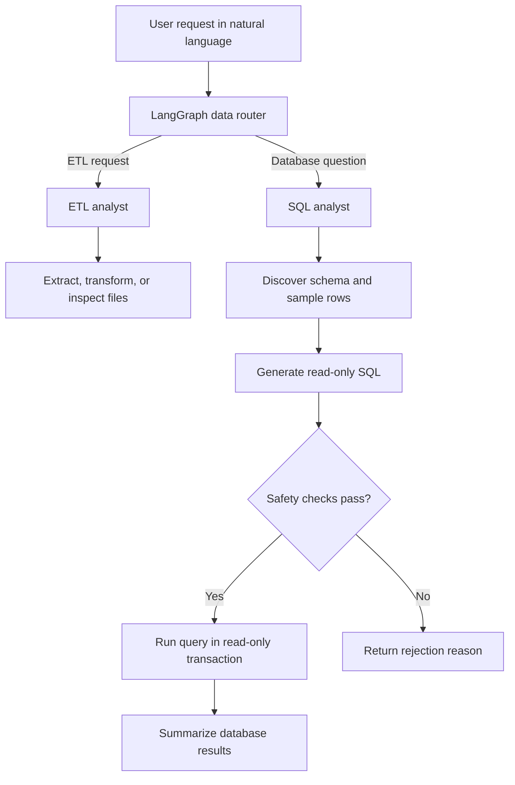

# Ola AI Data Agent

A natural-language data assistant for working with API data and PostgreSQL. The project uses **LangGraph** to route a request to the workflow that fits it: an ETL agent for extracting and transforming datasets, or a SQL analyst for asking questions about a database.

The idea is simple: describe a data task in plain English, let the router select a workflow, and get back a result—or an explanation of why the operation could not be completed.

> **Project status:** This is a learning project and a work in progress. The repository contains the core agent workflows, database-loading utilities, and graph visualizations. It is not currently a hosted web application, and production use would require additional hardening, testing, and operational work.

## What it does

- **Routes requests to the right workflow.** A LangGraph router classifies requests as ETL work or SQL analysis.
- **Extracts data from APIs.** The ETL workflow follows common paginated API responses, including responses with a `results` list and a `next` URL.
- **Saves datasets in familiar formats.** CSV, JSON Lines, and Parquet are supported by the ETL workflow.
- **Transforms data from instructions.** The ETL agent asks an LLM for a constrained JSON plan for selecting, dropping, renaming, sorting, filtering, deduplicating, and filling missing values. The operations are applied with pandas rather than by executing model-generated Python.
- **Answers questions about PostgreSQL.** The SQL workflow discovers table and column information, generates a query, applies read-only checks, runs it in a read-only transaction with a statement timeout, and summarizes returned rows.
- **Loads a sample rideshare dataset.** `feed_db.py` creates tables for users, vehicles, rides, payments, and ratings, then loads matching CSV files from a local `data/` directory.
- **Makes workflows easier to understand.** The repository includes graph images for the router, ETL workflow, and SQL workflow.

## How the pieces fit together

The main entry point for the agentic workflow is `agents/data_agent.py`.



### 1. Data router — `agents/data_agent.py`

The router uses a structured LLM response to choose between `etl` and `sql`. It then invokes the corresponding LangGraph workflow and returns the sub-agent's response. The current configuration uses Groq-hosted models through LangChain's `ChatGroq` integration.

### 2. ETL analyst — `agents/etl_analyst.py`

The ETL workflow exposes tools for extracting API data and transforming datasets. It supports CSV, JSON Lines (newline-delimited JSON), and Parquet. During extraction, it follows pagination links for common API response shapes, records how many pages and records were processed, and saves the output under the requested folder.

For transformations, the model proposes a JSON plan using a defined set of allowed operations. The Python code checks operation types and column names before applying them with pandas. This is more constrained than asking a model to write and execute arbitrary Python, though LLM-generated plans still need testing against malformed and unexpected inputs.

### 3. SQL analyst — `agents/sql_analyst.py`

The SQL workflow is intended for read-only analysis of PostgreSQL data. It retrieves schema information and a small sample of rows to provide context, generates SQL from the user's question, and checks the candidate query before execution. The implementation includes deterministic read-only validation, a structured LLM safety review, another validation immediately before execution, a read-only database transaction, and a 15-second statement timeout.

These checks reduce risk; they are not a substitute for least-privilege database credentials, database-side permissions, code review, and security testing.

### 4. Database utilities — `utils/database.py` and `feed_db.py`

`utils/database.py` retrieves table names, column types, and a limited sample of rows from PostgreSQL. `feed_db.py` defines a rideshare-style relational schema and loads CSV files into it. **Read the loader before running it:** it currently contains a `TRUNCATE ... CASCADE` statement that clears existing rows from the five target tables before loading.

### 5. Model selection — `utils/llm_pick.py`

The SQL workflow selects Groq models by a simple difficulty label. The current mapping uses `openai/gpt-oss-20b` for low-level tasks, `openai/gpt-oss-120b` for medium tasks, and `qwen/qwen3.8-27b` for high/Groq tasks. Model availability can change, so check the models enabled for your Groq account if a request fails.

## Repository layout

```text
Ola-Ai-Data-Agent/
├── agents/
│   ├── data_agent.py          # Routes a request to ETL or SQL
│   ├── etl_analyst.py         # API extraction and dataset transformations
│   ├── sql_analyst.py         # PostgreSQL question-answering workflow
│   └── scratch.py             # Experimental / scratch code
├── models/
│   └── schema.py              # Pydantic state and response schemas
├── utils/
│   ├── database.py            # PostgreSQL schema inspection helpers
│   ├── etl_tools.py           # Reusable API/data helpers
│   └── llm_pick.py            # Groq model selection
├── data_agent_graph.png       # Router workflow diagram
├── etl_analyst_graph.png      # ETL workflow diagram
├── sql_analyst_graph.png      # SQL workflow diagram
├── feed_db.py                 # Create rideshare tables and load CSVs
├── transform_pokemon.py       # Example dataset transformation
├── test_schema_details.txt    # Example schema-inspection output
├── pyproject.toml             # Project metadata and declared dependencies
└── README.md
```

Generated data is expected under `data/`, which is ignored by Git. Keep input datasets and credentials out of version control unless they are intentionally public and safe to share.

## Tech stack

| Component | Role |
|---|---|
| Python | Application language |
| LangGraph | Defines the router and task workflows as graphs |
| LangChain | LLM integration and tool orchestration |
| Groq API | Hosts the language models used by the agents |
| Pydantic | Defines agent state and structured response schemas |
| pandas | Reads, normalizes, transforms, and exports tabular data |
| requests | Makes HTTP requests to data APIs |
| PostgreSQL | Stores the sample rideshare data and supports SQL analysis |
| psycopg2 | Connects Python to PostgreSQL |
| python-dotenv | Loads local environment variables |

The checked-in `pyproject.toml` currently declares Python 3.13 or later, FastAPI, LangChain, LangChain Groq integration, and Pydantic. Some files also import packages such as LangGraph, pandas, requests, psycopg2, python-dotenv, Groq, and a Parquet engine directly. Make sure your environment has all required packages installed; the declared dependencies should be brought into line with the imports as the project evolves.

## Getting started

### Prerequisites

- Python 3.13 or a compatible version that meets the project's declared requirement
- A Groq API key with access to the configured models
- PostgreSQL, if you want to use the SQL analyst or load/query the rideshare dataset
- Git

### 1. Clone the repository

```bash
git clone https://github.com/Osamah-786/Ola-Ai-Data-Agent.git
cd Ola-Ai-Data-Agent
```

### 2. Create and activate a virtual environment

**Windows PowerShell**

```powershell
py -3.13 -m venv .venv
.\.venv\Scripts\Activate.ps1
python -m pip install --upgrade pip
```

**macOS / Linux**

```bash
python3.13 -m venv .venv
source .venv/bin/activate
python -m pip install --upgrade pip
```

### 3. Install dependencies

The current dependency declaration may not include every package imported by the code. Install the project and any missing runtime packages:

```bash
pip install -e .
pip install langgraph pandas requests python-dotenv psycopg2-binary groq pyarrow
```

`pyarrow` enables Parquet support with pandas. `psycopg2-binary` is convenient for local development; choose and pin the PostgreSQL driver according to your deployment standards for production. If installation reports version conflicts, resolve and record a compatible set rather than repeatedly installing packages without checking compatibility.

### 4. Configure environment variables

Create a file named `.env` in the project root. Do not commit this file.

```dotenv
GROQ_API_KEY=replace_with_your_new_groq_api_key

# PostgreSQL settings — needed for SQL analysis and feed_db.py
host=localhost
port=5432
database=ola-agentic-ai
user=postgres
password=replace_with_your_postgresql_password
```

The SQL code reads PostgreSQL connection settings from these environment variables. Keep the names consistent with the code. For hosted environments, use the platform's secret manager instead of uploading a `.env` file.

**Credential note:** if an API key has ever been committed, pasted into a public issue, or otherwise exposed, revoke it and create a replacement. Adding `.env` to `.gitignore` prevents future accidental additions but does not erase a secret from earlier Git history.

### 5. Confirm model access

The agents configure Groq model IDs in their Python files. Make sure those models are available to your account. If Groq returns a model-not-found or access error, update the model configuration in the router/ETL agent and `utils/llm_pick.py` to use a model currently enabled for your account.

## Running the agents

Run commands from the repository root with the virtual environment activated and `.env` configured.

### Run the combined data agent

```bash
python -m agents.data_agent
```

The module's built-in example asks the agent to extract data from the Pokémon API and save it to `data/extract` as CSV. It also attempts to write the router graph image. The example request is defined in the `if __name__ == "__main__"` block; edit it to try a different task.

### Run the ETL analyst directly

```bash
python -m agents.etl_analyst
```

The ETL module has its own example request and graph-generation logic. This is useful for debugging extraction and transformation separately from routing.

### Run the SQL analyst directly

```bash
python -m agents.sql_analyst
```

This requires a reachable PostgreSQL database with tables in the `public` schema. The direct-run example asks for payment methods in the database. If you have not loaded a dataset yet, create and populate the expected tables first.

### Inspect the PostgreSQL schema

```bash
python -m utils.database
```

This prints schema details and writes `test_schema_details.txt`. PostgreSQL and valid credentials are required.

## Example requests

These examples illustrate the types of requests the workflows are designed to handle. Results depend on the API endpoint, the local files, the database contents, and the model's output.

**Extract API data**

> Fetch the Pokémon API collection and save the results to `data/extract` as CSV.

**Transform a dataset**

> Read `data/extract/extracted_data.csv`, keep only the `name` and `url` columns, remove duplicate rows, and save the result as Parquet in `data/transformed`.

**Filter rows**

> Load `data/extract/extracted_data.csv` and keep only rows where the name contains “bulbasaur”.

**Ask a database question**

> What payment methods appear in the database?

> What is the average fare for completed rides?

The SQL examples require the relevant tables and columns to exist in PostgreSQL. ETL paths are resolved relative to the project root unless an absolute path is supplied.

## PostgreSQL dataset setup

The `feed_db.py` loader expects these CSV files inside a local `data/` directory:

```text
data/
├── users.csv
├── vehicles.csv
├── rides.csv
├── payments.csv
└── ratings.csv
```

It creates five related tables—`users`, `vehicles`, `rides`, `payments`, and `ratings`—with primary keys, foreign keys, selected indexes, and a rating constraint. Once PostgreSQL is running and environment variables are set, run:

```bash
python feed_db.py
```

**Important:** the script truncates these tables with `CASCADE` before loading. Run it only against a disposable development database or remove/guard the truncate block before using a database with data you need to preserve. The CSV IDs and relationships must also satisfy the table constraints.

## How the SQL safety flow works

The SQL analyst combines multiple checks to reduce the risk of running generated SQL:

1. The model receives table and column metadata plus a small sample of rows.
2. SQL generation is instructed to produce a single read-only `SELECT` statement.
3. Deterministic validation checks the candidate query before an LLM-based structured safety review.
4. The query is validated again immediately before execution.
5. Execution uses a read-only PostgreSQL transaction and a 15-second statement timeout.
6. The workflow fetches a bounded number of rows and asks the model to summarize only those results.

This is defense in depth, not a security guarantee. LLM output is unpredictable, and SQL parsing and authorization are difficult to secure comprehensively. Use a dedicated database role with only the required `SELECT` permissions, avoid connecting as a database owner or superuser, and test the validator against edge cases before using real data.

## Current limitations and sensible next steps

The repository is still evolving. Keep these points in mind before using it beyond local experiments:

- **No hosted interface is included:** the repository currently provides Python workflows, not a finished web application.
- **Dependencies need alignment:** imported packages and the checked-in dependency list are not yet fully in sync. A pinned, reproducible environment would improve onboarding.
- **Database bootstrap can delete data:** `feed_db.py` truncates the target tables. Use a disposable development database or change that behavior before running it.
- **Model IDs can change:** make model choices configurable and verify current availability before a run.
- **Automated tests should be added:** prioritize routing, pagination, transformation plans, SQL validation, database failures, and empty results.
- **Be careful with code execution:** `utils/etl_tools.py` includes an `execute_code` helper that uses Python `exec`. Its own warning is important: only use it with trusted code, or isolate execution in a properly designed sandbox. Do not pass untrusted user input or model-generated code to it.
- **Add observability and recovery:** structured logs, limited retries, clearer error categories, and run-level metadata would make failures easier to diagnose.
- **Improve reproducibility:** consider a pinned lockfile, a placeholder-only `.env.example`, a database setup guide, and CI checks.

## Security and data handling

- Never commit API keys, database passwords, tokens, or real customer data.
- Rotate any credential that has been exposed. Removing a line from the latest commit alone may not remove it from Git history.
- Use environment-specific secrets and a least-privilege PostgreSQL account.
- Review generated transformations and query results before using them in important workflows.
- Treat files, API responses, and prompts as untrusted input. Keep `execute_code` limited to trusted code unless it runs inside a proper sandbox.

## Contributing

Issues, bug reports, and improvements are welcome. A useful contribution includes a clear description of the problem, reproduction steps, and—where practical—tests covering the expected behavior. For agent or model changes, describe the affected workflow and configured model IDs, but never include API keys or database credentials.

## License

No license file is currently included in the repository. Until a license is added, assume that reuse and redistribution are not automatically granted. Add a license file if you intend to permit others to use or modify the code.

---

Built by [Shaikh Osamah Sharif](https://github.com/Osamah-786) as a hands-on exploration of agentic workflows for data engineering and database analysis.
